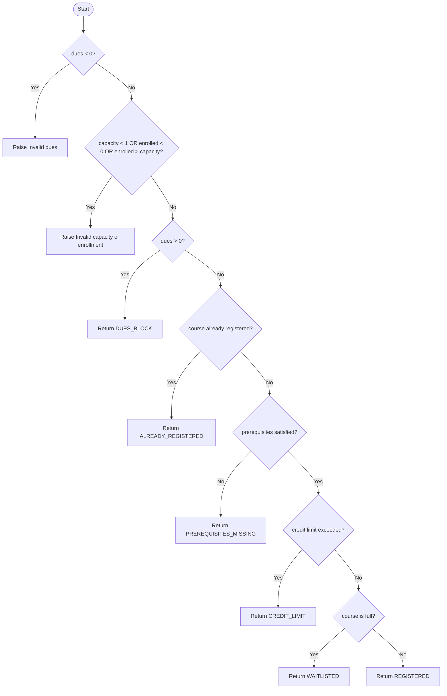

# Control Flow Graph and MC/DC Notes

## Control Flow Graph: `registration_decision(student, course)`

## MC/DC: `check_credit_limit`

Model the intended decision as three independent conditions:

- A: current credits are within 0..18.
- B: new course credits are within 1..4.
- C: current credits + new credits are at most 18.
- Decision: A AND B AND C. Invalid A or B raises the specified `ValueError`; otherwise C determines True/False.

| Pair | Test 1 (A,B,C) | Expected | Test 2 (A,B,C) | Expected | Condition isolated |
|---|---|---|---|---|---|
| 1 | current=15, new=3 (T,T,T) | True | current=-1, new=3 (F,T,T) | ValueError | A |
| 2 | current=15, new=3 (T,T,T) | True | current=15, new=0 (T,F,T) | ValueError | B |
| 3 | current=15, new=3 (T,T,T) | True | current=16, new=3 (T,T,F) | False | C |

The first two pairs demonstrate condition independence through the specified exception behavior; the third pair toggles only the total-credit condition. Record the exact test outcomes from the executed suite.
